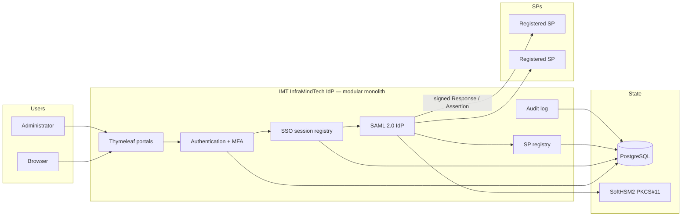

# IMT InfraMindTech Identity Provider

Production-grade **SAML 2.0 Identity Provider** for local identities, with RFC 6238 TOTP MFA, PKCS#11-backed signing, and PostgreSQL as the authoritative state store.

This tree contains **Phases 1–7**: architecture, identity, HSM signing, TOTP/sessions, SAML IdP, SLO, and production operations.

Repository: [github.com/sudheepnbr/Saj-n_Projects](https://github.com/sudheepnbr/Saj-n_Projects) · path `saml-mfa-idp/`

## What this system is

A standalone, enterprise-ready Identity Provider that:

- authenticates users from a local identity database
- enforces password policy, lockout, and TOTP MFA
- issues standards-compliant SAML 2.0 assertions to registered Service Providers
- signs with keys generated inside SoftHSM2 (PKCS#11) or a non-extractable software token in tests
- encrypts assertions with the **target SP's** public encryption certificate
- tracks IdP-wide SSO sessions and per-SP sessions
- supports SP-initiated and IdP-initiated SSO and Single Logout
- exposes a user self-service portal and a separated administrative console

## What this system is not

| Exclusion | Reason |
| --------- | ------ |
| LDAP / Active Directory | Local-identity-only platform |
| External IdPs, Entra ID, social login | No identity brokering |
| OAuth / OIDC authorization server | SAML 2.0 IdP only in this product |
| Keycloak at runtime | Independent implementation |
| Cloud identity dependency | Operates on-premises |
| Spring Security SAML as the IdP | Spring Security 7 is SP-only; IdP protocol is implemented directly |

## Current status

| Phase | Deliverable | Status |
| ----- | ----------- | ------ |
| **1** | Architecture, threat model, ADRs, roadmap | Complete on `main` |
| **2** | Users, passwords, RBAC, admin console | Complete |
| **3** | PKCS#11 / SoftHSM2 signing and rotation | **This PR** |
| **4** | TOTP, recovery codes, SSO sessions | **This PR** |
| **5** | SAML IdP, metadata, assertion issuance | **This PR** |
| **6** | SLO and SP interoperability notes | **This PR** |
| **7** | HA, monitoring, backup, production cutover | **This PR** |

**Run this app:** [`../START.md`](../START.md) (`./run.sh` or `docker compose up --build`). First-run token: `oih-local-setup`.

Architecture: [`docs/README.md`](docs/README.md) · ops: [`docs/runbooks/operations.md`](docs/runbooks/operations.md)

## Verified technology baseline

Pinned to **GA releases** checked on 16 November 2026. Snapshots and milestones are forbidden in the production baseline.

| Component | Pin | Evidence |
| --------- | --- | -------- |
| Java | 25 LTS | LTS; Spring Boot 4.1.2 supports Java 17–27 |
| Spring Boot | **4.1.2** | [System requirements](https://docs.spring.io/spring-boot/system-requirements.html), Maven Central GA |
| Spring Framework | 7.0.10 | Boot 4.1.2 BOM |
| Spring Security | **7.1.2** | Boot 4.1.2 BOM (`spring-security.version`) |
| Spring Session | 4.1.1 | Boot 4.1.2 BOM |
| OpenSAML | **5.2.3** | Architecture pin; see [ADR 0011](docs/adr/0011-xml-security-runtime.md) |
| Apache Santuario xmlsec | **4.0.4** | Compile-time SAML signature/encryption stack |
| Hibernate | 7.4.13.Final | Boot 4.1.2 BOM |
| Flyway | 12.4.0 | Boot 4.1.2 BOM |
| PostgreSQL driver | 42.7.14 | Boot 4.1.2 BOM |
| Thymeleaf | 3.1.5.RELEASE | Boot 4.1.2 BOM |
| Tomcat | 11.0.27 | Boot 4.1.2 BOM |
| PKCS#11 | Java SunPKCS11 | JDK 21–25 |
| HSM | SoftHSM2 | PKCS#11 token; replaceable with a physical HSM |
| Password hashing | Argon2id | `Argon2PasswordEncoder` + Bouncy Castle |
| MFA | RFC 6238 TOTP | Authenticator-compatible |

Full pins: [`docs/reference/version-baseline.md`](docs/reference/version-baseline.md)

## Architecture in one picture

## Hard rules

1. Signing private keys are generated in the token and never written to JKS, PKCS12, PEM, or the database.
2. Assertions are **signed** with the IdP token key and **encrypted** (when enabled) with the registered SP encryption certificate.
3. PKCS#11 keeps key *material* in the token; JVM objects, handles, and providers still exist. Do not claim private keys never touch the Java heap.
4. Unregistered SPs receive no assertions. ACS URLs are allow-listed, never taken from the request alone.
5. `MFA_PENDING` is not a fully authenticated state and cannot issue SAML assertions.
6. Replay detection, sessions, lockouts, and protocol correlation are stored in PostgreSQL so multiple instances cannot bypass them.
7. CSRF is not disabled globally. SAML POST bindings are explicit exceptions with compensating SAML validation.

## License

MIT. See [LICENSE](LICENSE).
