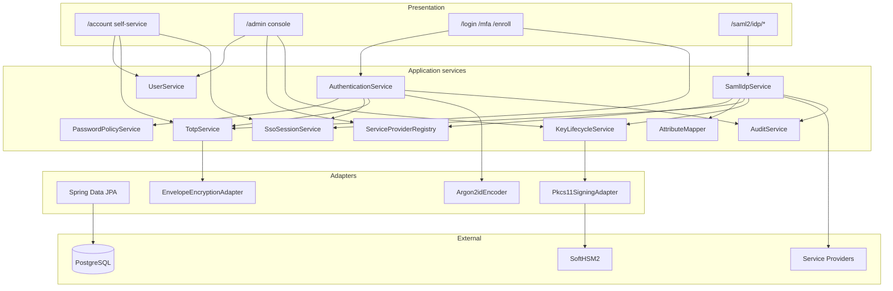
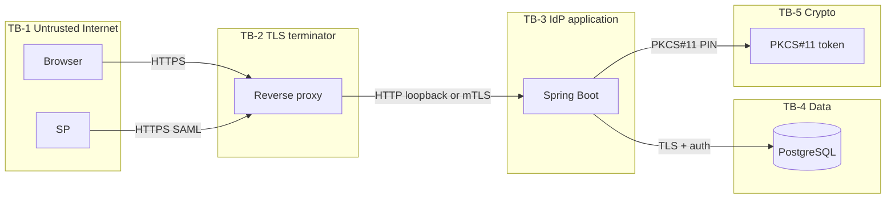
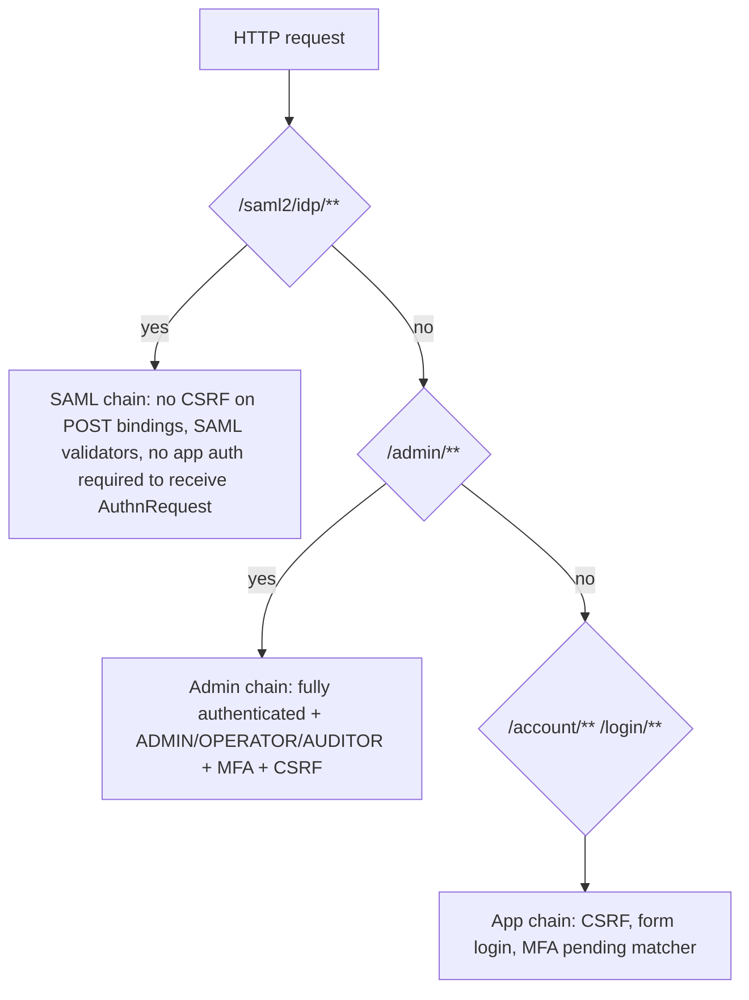
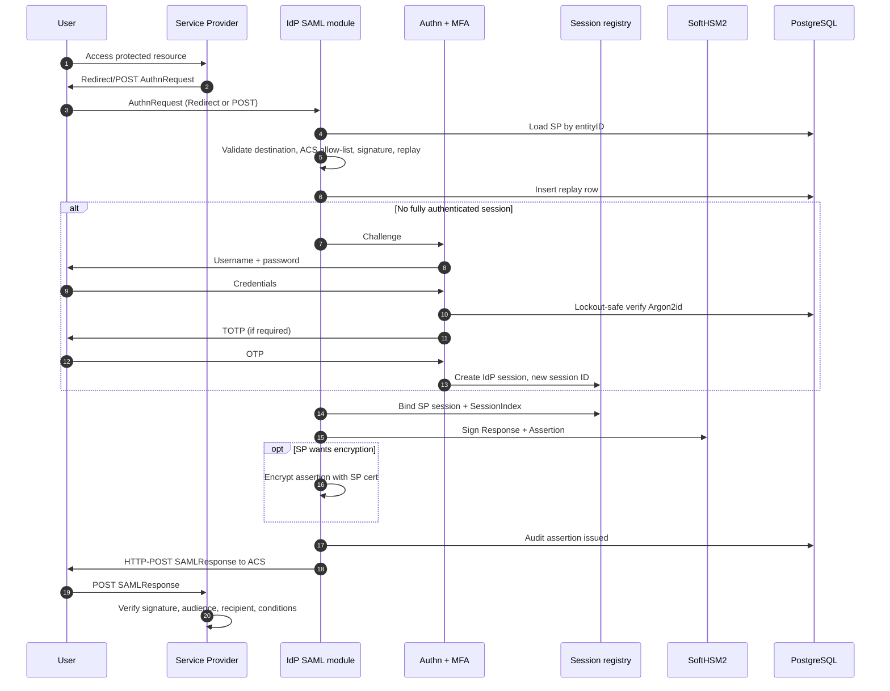

# Architecture blueprint

Approved design after the specification review. This is the document later phases implement.

## 1. Style

**Modular monolith.** One deployable Spring Boot application, one process, one PostgreSQL database, one PKCS#11 token (or HA network HSM). Modules communicate through Spring beans and interfaces, not HTTP.



## 2. Trust boundaries



| Boundary | What crosses | Control |
| -------- | ------------ | ------- |
| TB-1 → TB-2 | Browser and SP HTTP | TLS 1.2+, HSTS, size limits |
| TB-2 → TB-3 | Forwarded requests | Trusted forwarded-headers from the proxy only |
| TB-3 → TB-4 | SQL | Least-privilege DB role, TLS, parameterized queries |
| TB-3 → TB-5 | Sign operations, public cert read | PIN from secret manager; no key export |
| Admin UI | Privileged HTML | Separate security chain, MFA mandatory, step-up |

SAML assertions leave TB-3 toward SPs. They are signed (and optionally encrypted) **before** they leave.

## 3. Security filter chains

Three chains, most specific first.



Rules:

- Receiving an AuthnRequest does **not** authenticate the user.
- Completing SAML SSO requires `FullyAuthenticated` IdP session (password + MFA when policy requires it).
- `MfaPendingAuthenticationToken` may access only `/login/mfa/**` and `/logout`.
- `/saml2/idp/metadata` is public and cacheable; it contains public certificates only.

## 4. Runtime collaboration — SP-initiated SSO



## 5. Module dependency rules

Allowed direction: presentation → application → domain → adapters.

Forbidden:

- SAML module calling Thymeleaf templates directly for business decisions
- Crypto module depending on SAML XML types (it signs **bytes** / XMLSignatures via a narrow interface)
- User module depending on OpenSAML
- Circular AUTH ↔ SAML. SAML asks Session: “is this user fully authenticated?” Session does not parse SAML.

## 6. Interface catalogue (stable contracts)

```
SigningService
  sign(bytes | XMLObject, KeyRef) -> SignatureResult
  publicCertificates(KeyUse.SIGNING) -> List<CertificateView>

EncryptionService
  encryptAssertion(Assertion, SpEncryptionCert) -> EncryptedAssertion

SsoSessionService
  getActiveIdpSession(user)
  createFullyAuthenticatedSession(...)
  associateSpSession(idpSession, sp, sessionIndex)
  revoke(sessionId)
  revokeAll(userId)

ReplayGuard
  consume(messageId, type, notOnOrAfter) -> void  // throws ReplayException

ServiceProviderRegistry
  requireEnabled(entityId) -> ServiceProvider
  validateAcs(sp, acsUrl, binding) -> AcsEndpoint

TotpService
  verify(user, code)
  enroll(user, secret)
  verifyRecovery(user, code)

AuditService
  record(SecurityEvent)  // never accepts secret fields
```

These interfaces are the Phase 2–5 implementation spine.

## 7. Configuration topology

| Profile | Database | HSM | Cookies | TLS |
| ------- | -------- | --- | ------- | --- |
| `dev` | Testcontainers PostgreSQL (preferred) or local Postgres | SoftHSM2 | Secure=false only on loopback | optional |
| `test` | Testcontainers PostgreSQL | SoftHSM2 in Docker or test token | n/a | n/a |
| `prod` | PostgreSQL | SoftHSM2 or PKCS#11 network HSM | Secure=true, SameSite per binding config | required |

H2 is a **non-default** convenience profile (`dev-h2`) that must refuse to start if SAML signing is enabled.

## 8. Package layout (preview)

See [`reference/package-structure.md`](reference/package-structure.md). Top-level:

```
com.oih.idp
  config
  identity
  policy
  mfa
  session
  saml
  sp
  mapping
  crypto
  keys
  audit
  account
  admin
  web
```

## 9. What “enterprise-ready” means here

- Fail closed: missing HSM, missing signing key, clock-unsynchronized beyond threshold, or DB outage → readiness **down**, no assertions.
- Default-deny attribute release.
- Default-deny SP (explicit registration).
- Default MFA required before first assertion.
- Default signed responses **and** signed assertions.
- Default production refusal of HTTP (non-TLS) ACS URLs.
- Default algorithm allow-list (RSA-SHA256, SHA-256 digest, Exclusive C14N).

## 10. Out of scope for the blueprint

OIDC, LDAP, social login, artifact binding, SOAP back-channel, clustering the SoftHSM file token across nodes, and native-image builds.
