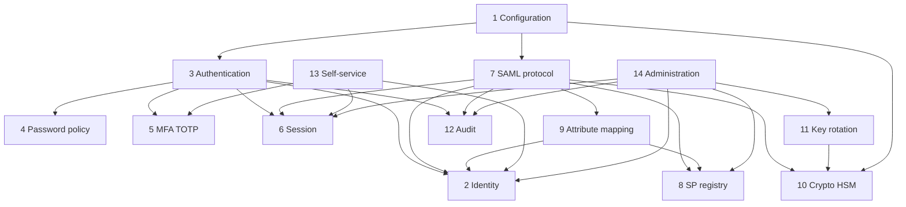

# Module catalogue

Fourteen logical modules inside one Spring Boot application. Each module owns a package, a data slice, and a security control. No module is a microservice.

## Dependency map

Circular dependencies are forbidden. If two modules need each other, extract a third SPI in `idp-api` style packages (`session.spi`, `crypto.spi`).

---

## 1. Configuration module

**Responsibility:** typed configuration (`IdpProperties`), profile validation, fail-fast on illegal prod combinations.

**Trust:** reads environment and secret manager references, never raw files committed to git.

**Controls:**

- `prod` refuses default passwords, HTTP ACS, in-memory replay, and H2.
- Binding-level SameSite derived from enabled SAML bindings.
- Clock-skew, assertion TTL, request max age, lockout thresholds.

**Depends on:** nothing.

---

## 2. Identity and user management

**Responsibility:** users, roles, uniqueness, enablement, lock timestamps.

**Entities:** `User`, `Role`, `UserRole`.

**Controls:** UUID primary keys; unique username and email; no comma-separated roles; never expose sequential DB IDs in URLs (UUIDs only).

**Does not:** authenticate, hash policy decisions, or speak SAML.

---

## 3. Authentication

**Responsibility:** username/password verification, generic error messages, transition to MFA-pending or fully authenticated, login CSRF, enumeration resistance.

**Controls:** constant-time-ish failure path (hash dummy on unknown user); no “user not found” vs “bad password”; audit outcomes without usernames in info logs when enumeration-sensitive (store user id only if resolved).

---

## 4. Password policy

**Responsibility:** length, complexity, history, optional expiry, breached-password screening.

**Controls:** Argon2id encode/match; history of previous hashes; local k-anonymity or offline hash list — **no plaintext leave the process**. Periodic expiry **off** by default.

---

## 5. MFA and TOTP

**Responsibility:** secret generation, QR/`otpauth` URI, verification window, OTP replay, recovery codes, enrollment state.

**Controls:** secrets encrypted at rest with envelope key; recovery codes hashed; `MFA_PENDING` cannot escape matcher; enrollment confirmation requires a valid TOTP before the secret is marked active (prevents QR screenshot enrollment without proving possession).

---

## 6. Session management

**Responsibility:** IdP SSO session, per-SP associations, session indexes, idle/absolute timeout, concurrent caps, revocation.

**Controls:** Spring Session JDBC; session ID regeneration on privilege step-up; server-side registry is authoritative, cookies are pointers.

---

## 7. SAML 2.0 protocol

**Responsibility:** metadata, AuthnRequest, Response, Assertion, LogoutRequest/Response, bindings, validation pipeline.

**Controls:** OpenSAML only — no string-built XML. Parser pool hardened. Algorithm allow-list. ACS from registry.

**Depends on:** 6, 8, 9, 10, 2.

---

## 8. Service Provider registry

**Responsibility:** trusted SP records, ACS/SLO allow-lists, certificates, binding support, encryption preference, auth requirements.

**Controls:** YAML bootstrap may **insert** SPs only when entityID is unknown; never override a DB row from a file in `prod`. Certificate validation at write time.

---

## 9. Attribute mapping

**Responsibility:** per-SP protocol mappers, release policies, role filters.

**Controls:** default deny. Block internal fields (`passwordHash`, `totpCiphertext`, `lockUntil`, `failedLogins`).

---

## 10. Cryptographic and HSM

**Responsibility:** load SunPKCS11 dynamically, PIN, sign, verify, health sign-and-verify, non-extractability checks at startup.

**Controls:** `CKA_SIGN=true`, `CKA_DECRYPT=false` on signing keys. No file keystores for SAML signing keys.

---

## 11. Certificate and key rotation

**Responsibility:** active / next / retiring, metadata publication, activation, retirement grace, fingerprint inventory.

**Controls:** metadata lists active + next; signing uses active only; retiring remains in metadata until grace ends if SPs still need it for verification of in-flight responses (usually short). Never DELETE token objects that DB still references.

---

## 12. Audit and monitoring

**Responsibility:** structured security events, redaction, append-only storage, admin query.

**Controls:** JSON logs for ops; relational audit for security. Separate from application debug logs. No secrets, no full assertions, no cookies.

---

## 13. User self-service (`/account`)

**Responsibility:** profile, password change, TOTP enroll/reset, recovery codes, session list/revoke, recent security events.

**Controls:** CSRF, step-up for sensitive actions, no secret display after enrollment confirmation.

---

## 14. Administrative management (`/admin`)

**Responsibility:** users, SPs, certificates, keys, sessions, audit viewer.

**Controls:** role separation, mandatory MFA, reauthentication for key rotation, password reset, MFA reset. Break-glass procedure documented, not a hidden backdoor.

---

## Security controls by module (summary)

| Module | Primary control |
| ------ | --------------- |
| Config | Fail-fast production invariants |
| Identity | Uniqueness, RBAC model |
| Authn | Enumeration-safe login, lockout |
| Password | Argon2id, history, breach screen |
| MFA | Possession proof, encrypted secrets |
| Session | JDBC registry, fixation defense |
| SAML | OpenSAML validation pipeline |
| SP registry | Allow-lists, cert trust |
| Mapping | Default-deny release |
| Crypto | PKCS#11 non-extractable sign |
| Keys | Overlapping metadata rotation |
| Audit | Append-only, redacted |
| Self-service | Step-up |
| Admin | SoD + MFA |
