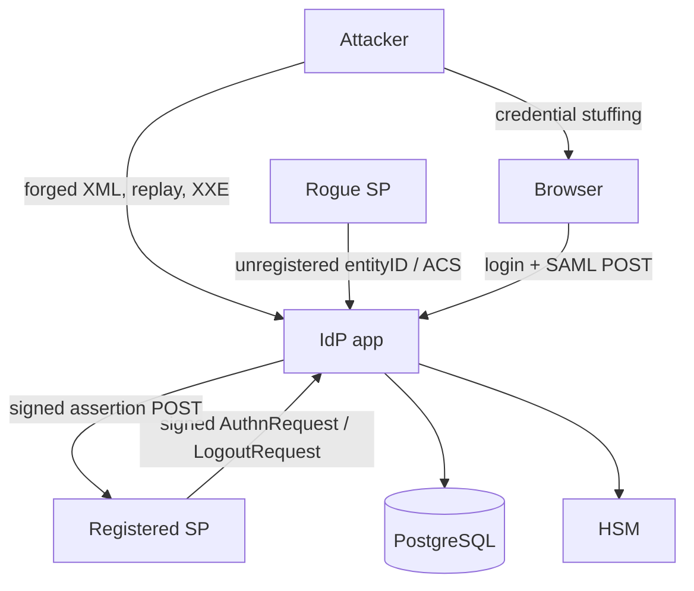

# Trust boundaries and threat model

Method: STRIDE on each trust boundary and on the IdP’s privileged use cases. Residual risks are accepted only when compensating controls exist.

## Assets

| Asset | Sensitivity | Store |
| ----- | ----------- | ----- |
| User password | Secret (hash only at rest) | PostgreSQL Argon2id |
| TOTP secret | Secret | PostgreSQL, envelope-encrypted |
| Recovery codes | Secret (hash only) | PostgreSQL |
| SAML signing private key | Secret | HSM token, non-extractable |
| Envelope key (TOTP) | Secret | Secret manager / env |
| HSM PIN | Secret | Secret manager / env |
| TLS private key | Secret | Separate from SAML HSM policy |
| SSO session | Credential | PostgreSQL + HttpOnly cookie |
| Persistent NameID | PII / linkability | PostgreSQL |
| Assertions | Bearer authz token | In transit only; not stored |
| Audit log | Integrity-sensitive | PostgreSQL append-only |
| SP encryption cert | Public but trusted | PostgreSQL |

## Actors

- Anonymous internet
- Authenticated user (MFA pending)
- Fully authenticated user
- Administrator / operator / auditor
- Registered SP
- Unregistered SP / attacker-SP
- Compromised SP
- Insider with DB access
- Insider with host/HSM filesystem access

## STRIDE catalogue

### S — Spoofing

| Threat | Control |
| ------ | ------- |
| Password guessing | Argon2id, progressive lockout, IP+account rate limit |
| Username enumeration | Generic errors, dummy hash, same timing band |
| Stolen TOTP | Replay cache of used OTP slots; recovery codes single-use |
| Forged AuthnRequest | Per-SP `wantAuthnRequestsSigned`; else still check issuer+ACS+destination |
| Forged assertion to SP | IdP signs; SP verifies. Out of IdP control if SP misconfigured — document |
| Admin UI without MFA | Mandatory MFA for admin roles |
| Metadata substitution | Signed metadata + out-of-band fingerprint |

### T — Tampering

| Threat | Control |
| ------ | ------- |
| XML Signature Wrapping | OpenSAML signature on the object later consumed; ID references; no second parse |
| ACS swap | Allow-list; ignore request ACS if not listed |
| Attribute injection | Mapper reads local user, not request |
| Audit edit | INSERT-only DB grant; no update API |
| SP registry YAML override | Prod: file cannot clobber DB |

### R — Repudiation

| Threat | Control |
| ------ | ------- |
| “I did not reset MFA” | Audit with actor, IP, UA, correlation id |
| Admin key rotation denial | Audit + reauthentication event |

### I — Information disclosure

| Threat | Control |
| ------ | ------- |
| TOTP in logs | Redaction filters; structured event schema without secret fields |
| Assertion in logs | Log IDs, entityIDs, not XML |
| Error stack traces to users | Generic HTML errors in prod |
| Directory listing of metadata extra keys | Metadata is public by design — only public certs |
| H2 console | Disabled |

### D — Denial of service

| Threat | Control |
| ------ | ------- |
| Huge XML | Max body 256 KiB on SAML endpoints |
| Billion laughs / XXE | DTD off, external entities off |
| Login flood | Rate limit + lockout; not only in-memory |
| HSM exhaustion | Bounded signing executor + timeout |
| Replay table growth | TTL + scheduled purge |

### E — Elevation of privilege

| Threat | Control |
| ------ | ------- |
| MFA pending issues assertion | Authorisation: SAML issuance requires `FULLY_AUTHENTICATED` |
| User hits `/admin` | Method + matcher role checks |
| Operator rotates signing keys | Permission `keys:rotate` only on ADMIN |
| Session fixation to admin | New session ID on login and on MFA |
| Forced browsing to enrollment skip | Enrollment required by policy before SAML |

## Abuse cases (must be tests)

1. Unsigned AuthnRequest from SP that requires signing → reject.
2. AuthnRequest with attacker ACS → reject.
3. Valid user password, skip MFA, call `/saml2/idp/sso` → no assertion.
4. Replayed AuthnRequest ID → reject on node A and node B.
5. Encrypted assertion using certificate from the request → never; only registry cert.
6. SP registration with expired signing cert → reject.
7. Recovery code reuse → reject.
8. CSRF on `/account/password` → reject; CSRF absent on SAML POST → allowed only after SAML validation.
9. YAML bootstrap tries to change an existing ACS in prod → ignored + audit.
10. `IsPassive=true` with no session → `Responder/NoPassive`, no login page.

## Residual risks (accepted)

| Risk | Why accepted | Mitigation |
| ---- | ------------ | ---------- |
| Front-channel SLO cannot reach an SP | Browser closed, SP down | Document partial logout; provide admin revoke; recommend short SP sessions |
| SoftHSM disk compromise | Software token | Filesystem perms, encrypted disk, migrate to hardware HSM |
| Stolen TOTP device | Possession factor | Recovery codes + admin reset with notify; future WebAuthn out of v1 |
| Compromised SP uses valid assertion | Bearer token | Short assertion TTL (5 min default), optional encryption, no extra replay at SP |
| PKCS#11 pinning under virtual threads | Native library | Bounded platform-thread signer |
| In-flight assertion after session revoke | Already posted | Short TTL; SLO best effort |

## Threat model diagram

