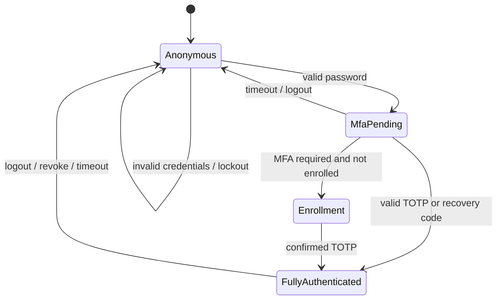
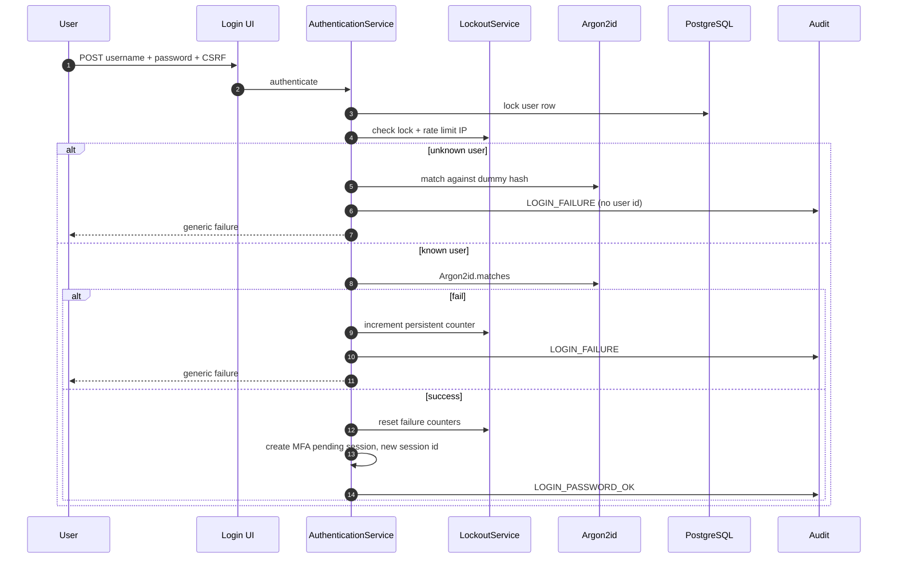
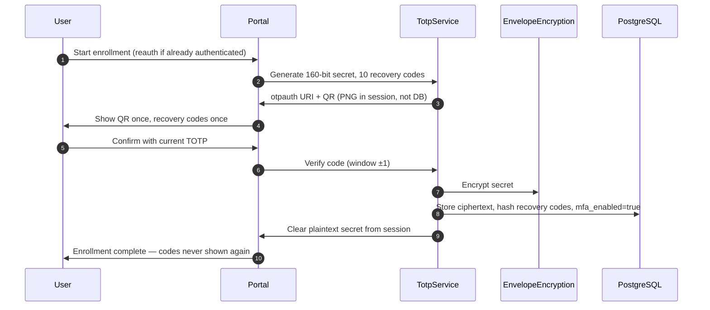

# Authentication and MFA

## Authentication states

| State | Spring Security representation | May issue SAML | May use /account | May use /admin |
| ----- | ------------------------------ | -------------- | ---------------- | -------------- |
| Anonymous | unauthenticated | No | No | No |
| MFA pending | `MfaPendingAuthenticationToken` + `MFA_PENDING` | **No** | No | No |
| Enrollment pending | `MfaEnrollmentAuthenticationToken` | **No** | Enrollment pages only | No |
| Fully authenticated | `UsernamePasswordAuthenticationToken` (or equivalent) + roles | Yes | Yes | If admin role + MFA already satisfied |

`ROLE_MFA_PENDING` is **not** stored on the user. It is a transient granted authority on the pending token only.

## Password authentication sequence

## Password policy (defaults)

| Setting | Default | Notes |
| ------- | ------- | ----- |
| Min length | 12 | Configurable |
| Max length | 128 | Reject extra to stop DoS on Argon2 |
| Complexity | 3 of 4 classes | Upper, lower, digit, symbol |
| History | Last 5 hashes | Compared on change only |
| Expiry | Off | Not a default control |
| Breach screen | Optional | k-anonymity prefix of SHA-1 to HIBP **or** local bloom; plaintext never sent |
| Encoder | Argon2id | `Argon2PasswordEncoder` with parameters tuned to ~200–500 ms on prod hardware; record params in config |

Argon2id requires Bouncy Castle at runtime. Use the encoder as a Spring bean, not `PasswordEncoderFactories.createDelegatingPasswordEncoder()`’s bcrypt default. A **delegating** encoder is still used so future algorithm upgrades can rehash on success (`{argon2id}` id).

## Brute force

Persistent `credential_guard` table (or columns on `users` plus `auth_source_throttle`):

- per username: failures, lock_until, progressive delay (0s, 1s, 5s, lock 15m, lock 1h)
- per source IP: sliding window in PostgreSQL
- success resets user failures, not IP reputation immediately (slow-reset)

Multiple instances share this table. In-memory counters are not sufficient.

## TOTP enrollment

Rules:

- Secret is not active until confirmation succeeds.
- QR image is not written to disk.
- Recovery codes shown **once**; hashed with Argon2id (or HMAC-SHA256 with a dedicated pepper) plus unique salt.
- Issuer label in `otpauth://` is the configured IdP display name.

## TOTP verification

- RFC 6238, SHA-1 (authenticator compatibility), 6 digits, 30 s.
- Window: ±1 period default.
- Replay: store last accepted `(user_id, timestep)` and reject the same timestep.
- Recovery code success: consume code, optionally require TOTP re-enrollment if policy `recovery_requires_reset=true` (default true).

## MFA reset protection

| Actor | Allowed | Extra control |
| ----- | ------- | ------------- |
| User | Disable/reset own MFA | Password reauth + one valid TOTP or recovery code |
| Admin | Reset user MFA | Admin MFA + reauth + reason field + notify user + revoke sessions |
| Break-glass | Reset admin MFA | Dual operator, or offline documented procedure with audit after |

## SAML interaction

No code path from `SamlIdpService` to assertion issuance may accept `MfaPending` or `EnrollmentPending`. The check is:

1. Spring Security matcher (filter)
2. Service-level assertion (`SsoSessionService.requireFullyAuthenticated()`)
3. Test matrix case “MFA bypass”

Password-only SPs are an explicit SP flag `mfaRequired=false` **and** global policy must allow it. Default global: MFA required for all SPs.
