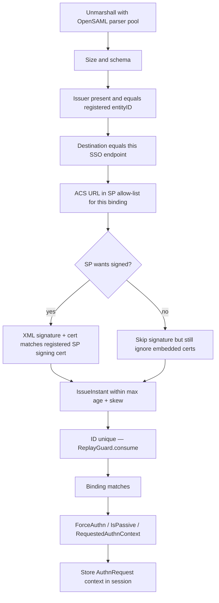
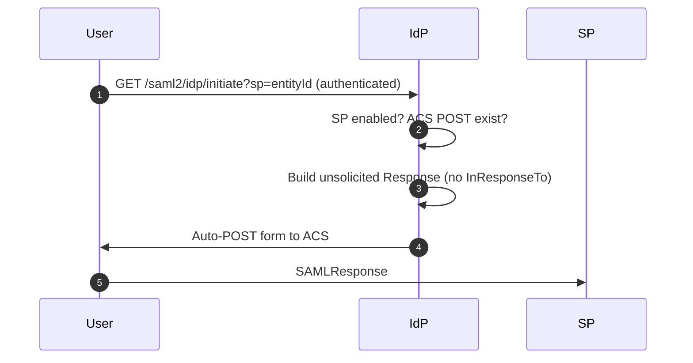

# SAML 2.0 protocol design

Architecture pin: **OpenSAML 5.2.3**. Runtime in this repository: hardened DOM + Apache Santuario 4.0.4 (see [ADR 0011](adr/0011-xml-security-runtime.md)). No Spring Security IdP APIs.

## Endpoints

| Path | Binding | Auth |
| ---- | ------- | ---- |
| `GET /saml2/idp/metadata` | HTTPS | Public |
| `GET /saml2/idp/sso` | HTTP-Redirect SSO | Public to receive request; issuance needs full session |
| `POST /saml2/idp/sso` | HTTP-POST SSO | Same |
| `GET /saml2/idp/slo` | HTTP-Redirect SLO | Public to receive LogoutRequest |
| `POST /saml2/idp/slo` | HTTP-POST SLO | Same |
| `GET /saml2/idp/initiate` | IdP-initiated SSO | Fully authenticated |
| `POST /account/logout-global` | IdP-initiated SLO | Fully authenticated + CSRF |

Entity ID (example): `https://idp.example.org/saml2/idp/metadata`

## Metadata contents

OpenSAML `EntityDescriptor` / `IDPSSODescriptor`:

- entityID
- `WantAuthnRequestsSigned` (IdP default true, overridable)
- SSO services: Redirect + POST
- SLO services: Redirect + POST
- NameIDFormat: persistent, emailAddress, transient, unspecified
- KeyDescriptors: `use=signing` for **active** and **next** certificates
- optional `use=encryption` is **not** advertised for the IdP in v1 (IdP does not decrypt SP assertions)

Metadata is signed. Fingerprints of signing certs are shown in the admin console for out-of-band SP configuration (FortiGate, Shibboleth, etc.).

## AuthnRequest validation pipeline

Order is mandatory. Fail closed.

Additional rules:

- Do not trust `KeyInfo` inside the request. Compare digest of the **validated** signing cert to the registry.
- Reject unknown signature algorithms.
- `AssertionConsumerServiceIndex` is resolved against registered ACS entries, never against SP-supplied extra URLs.
- Malformed XML → 400, generic message, audit `SAML_REQUEST_INVALID`.

## Assertion profile

Signed SAML `Response` (HTTP-POST) containing one `Assertion`.

| Element | Rule |
| ------- | ---- |
| Response.ID | Crypto-strong, `id` NCName |
| Response.InResponseTo | Request ID, omitted for IdP-initiated |
| Response.Destination | SP ACS URL actually used |
| Issuer | IdP entityID, format entity |
| Subject.NameID | Per SP format |
| SubjectConfirmation | bearer |
| SubjectConfirmationData.Recipient | Same ACS |
| SubjectConfirmationData.NotOnOrAfter | now + assertion TTL + skew |
| SubjectConfirmationData.InResponseTo | Request ID if any |
| Conditions.NotBefore / NotOnOrAfter | skew-aware |
| AudienceRestriction | SP entityID only |
| AuthnStatement.SessionIndex | IdP session index |
| AuthnStatement.AuthnContextClassRef | PasswordProtectedTransport or TimeSyncToken |
| AttributeStatement | Mapper output only |
| Signature | Response **and** Assertion, RSA-SHA256 |

Default TTL: **5 minutes**. Clock skew: **2 minutes**. Request max age: **10 minutes**.

## IdP-initiated SSO

CSRF: initiate is GET with session cookie; acceptable if SameSite is Lax/None as configured. Prefer POST + CSRF for the initiate button in `/account`.

## Algorithm allow-list

| Use | Allowed |
| --- | ------- |
| Signature | `http://www.w3.org/2001/04/xmldsig-more#rsa-sha256` |
| Optional signature | `ecdsa-sha256` if SP compatibility requires and key is P-256 |
| Digest | SHA-256 |
| C14N | Exclusive C14N without comments |
| Transform | Enveloped signature + Exclusive C14N |
| Data encryption | AES-256-GCM default; AES-128-CBC / AES-256-CBC per SP |
| Key transport | RSA-OAEP (1.1) with SHA-256 and MGF1-SHA256; fallback RSA-OAEP-MGF1P |
| Forbidden | SHA-1 signatures, RSA-1.5, HMAC-SHA1 for SAML signatures, MD5 |

SAML 2.0 conformance historically required RSA-SHA1. We **do not** offer SHA-1 in v1. SPs that cannot verify RSA-SHA256 are unsupported.

## XML parser hardening

- OpenSAML `ParserPool` only
- `http://apache.org/xml/features/disallow-doctype-decl` = true
- `external-general-entities` / `external-parameter-entities` = false
- Max inbound SAML body 256 KiB
- Expand entity count = 0

## CSRF exception (justified)

SAML HTTP-POST AuthnRequest and LogoutRequest are cross-site POSTs without a CSRF token. The SAML chain disables CSRF **only** for:

- `POST /saml2/idp/sso`
- `POST /saml2/idp/slo`

Compensating controls: destination, issuer, ACS allow-list, optional/required signature, replay, size limit. All other POST endpoints keep CSRF.

The auto-POST HTML form that sends a Response **to the SP** is an outbound form; CSP must allow `form-action` to registered ACS origins.

## Interoperability

See [`reference/interoperability-matrix.md`](reference/interoperability-matrix.md). v1 protocol tests must include at least one independent SP (Spring Security SAML SP test app, and optionally Keycloak-as-SP, Shibboleth SP, or SimpleSAMLphp).
