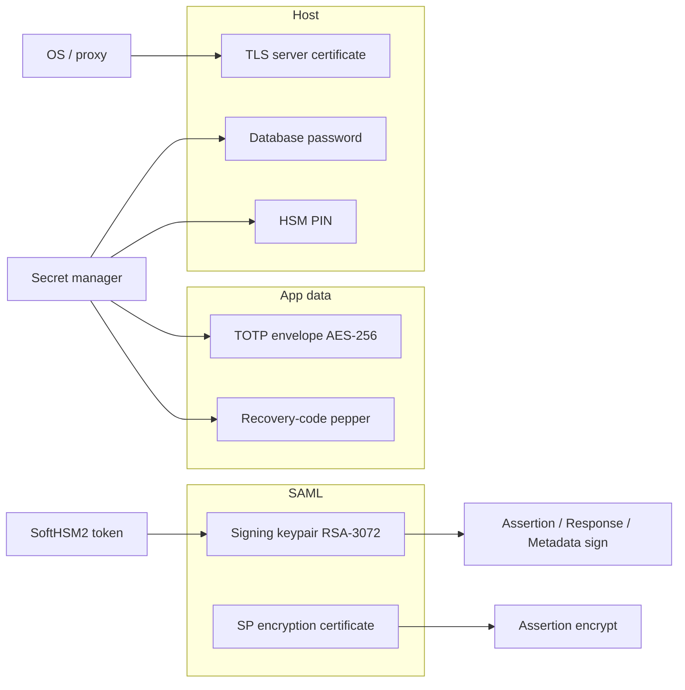
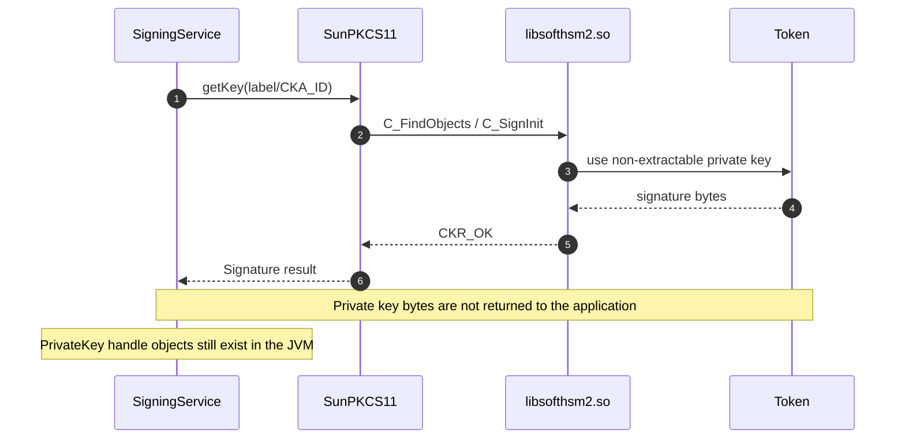
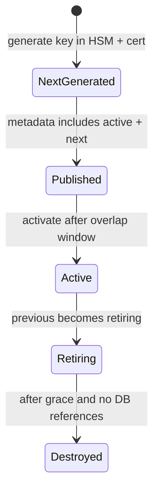

# Cryptography and HSM

## Key separation (non-negotiable)



The SAML signing private key is **not** used for:

- TLS
- TOTP secret wrapping
- database encryption
- recovery-code HMAC
- decrypting anything (`CKA_DECRYPT=false`)

## PKCS#11 architecture



Migration path: replace `libsofthsm2.so` and slot/PIN configuration with a physical HSM PKCS#11 library. `SigningService` does not change.

## Startup checks

1. PKCS#11 library file exists and is readable.
2. Provider registers.
3. Login with PIN from environment (`OIH_HSM_PIN`) or secret manager — never from `application.yml` in prod.
4. Locate active key by CKA_ID from database.
5. Confirm `CKA_EXTRACTABLE=false` (and `CKA_SENSITIVE=true`) via PKCS#11 attribute read. Fail startup if extractable.
6. Sign a random 32-byte nonce, verify with the public certificate. Fail readiness if mismatch.
7. Do not log PIN, nonce is OK.

## Certificate binding

Correct lab procedure (see also [`runbooks/softhsm2.md`](runbooks/softhsm2.md)):

1. `softhsm2-util --init-token`
2. Generate RSA-3072 **inside** the token (`pkcs11-tool --keypairgen` or `keytool -genkeypair -storetype PKCS11`).
3. The public key from that generation is the only public key that may appear in the X.509 certificate.
4. Lab: self-signed cert created by keytool against the PKCS#11 keystore (keytool hashes the public key from the token).
5. Production: export a CSR using the token key (`keytool -certreq -storetype PKCS11` or `openssl` with PKCS#11 engine), sign with enterprise CA, import **certificate only** back to the token and to PostgreSQL.

Never import a certificate whose public key does not match the token private key.

## Preferred algorithms

| Item | v1 baseline |
| ---- | ----------- |
| Signing key | RSA-3072 |
| Signing alg | RSA-SHA256 |
| Optional | ECDSA P-256 / ECDSA-SHA256 if a named SP requires it |
| Assertion data encryption | AES-256-GCM |
| Key transport | RSA-OAEP, SHA-256, MGF1-SHA256 |
| TOTP at rest | AES-256-GCM envelope |
| Passwords | Argon2id |
| Recovery codes | Argon2id or HMAC-SHA256 + unique salt |

RSA-3072 is the interoperability baseline (Windows, FortiGate, Shibboleth, SimpleSAMLphp, Spring Security SP).

## Rotation



| Role | Signs new messages | Present in metadata |
| ---- | ------------------ | ------------------- |
| active | Yes | Yes |
| next | No | Yes (overlap) |
| retiring | No | Optional short period |
| destroyed | No | No |

Process:

1. Generate new keypair in HSM with new CKA_ID and label.
2. Bind certificate.
3. Insert `signing_keys` row `status=NEXT`.
4. Metadata now publishes active + next.
5. Wait configured overlap (default 7 days) or admin “activate now”.
6. Transaction: old `ACTIVE` → `RETIRING`, `NEXT` → `ACTIVE`.
7. After `retirement_grace` (default 30 days) and zero references, delete DB row then destroy token object.

Never destroy a key still listed as active in any replica’s config.

Admin UI shows notAfter, SHA-256 fingerprint, CKA_ID, and days remaining. Alert at 30 / 14 / 7 days.

## Encryption of assertions

```
plaintext Assertion XML
   │
   ├─ XML Signature (IdP HSM private key)
   │
   └─ optional EncryptedAssertion
         EncryptedData  AES-256-GCM  (ephemeral data key)
         EncryptedKey   RSA-OAEP     (SP encryption public key)
         DigestMethod + MGF included
```

Certificate source: `sp_certificates` where `use=ENCRYPTION` and `validated_at` succeeded. Not from the AuthnRequest.

If the SP has no encryption certificate and `encrypt_assertions=true`, refuse issuance (fail closed).

## SoftHSM operational reality

- Token files are secret material, equivalent to a wrapped key backup.
- Backup = token directory + `softhsm2.conf` + SO-PIN + user PIN, stored separately from DB backups but restored together.
- File permissions: `0700` dir, `0600` files, dedicated OS user.
- SoftHSM is not FIPS-validated. Hardware HSM is a production assurance upgrade, not an application rewrite.
