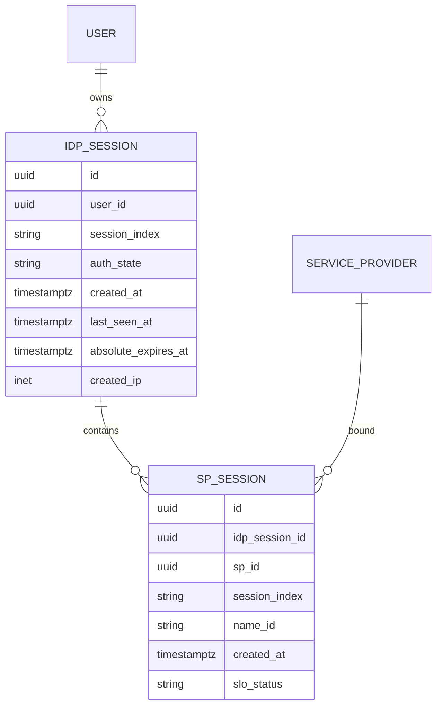
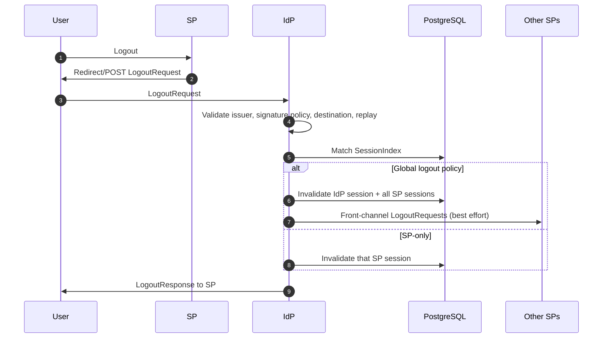
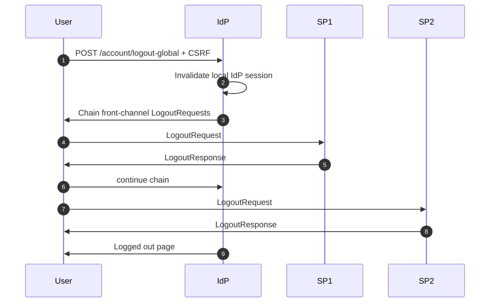

# Sessions and Single Logout

## Why PostgreSQL sessions

A single-node IdP still gets a second node during patching. In-memory Spring Session, in-memory replay, and in-memory lockout would allow:

- a second node to miss a logout
- a second node to accept a replayed AuthnRequest
- lockout bypass by alternating nodes

v1 uses:

- **Spring Session JDBC** for HTTP sessions
- **idp_sessions** / **sp_sessions** for SAML SessionIndex correlation (may be the same store with extra tables)
- **replay_cache** for protocol IDs

## Session model

`session_index` is what AuthnStatement and LogoutRequest use. It is not the HTTP cookie value.

## Cookie policy

| Attribute | Production |
| --------- | ---------- |
| Name | `OIHIDPSESS` (configurable) |
| HttpOnly | true |
| Secure | true |
| Path | `/` |
| SameSite | `None` if HTTP-POST SSO/SLO enabled; else `Lax` |
| Max-Age / idle | idle 30 minutes default |
| Absolute timeout | 8 hours default |

`SameSite=Strict` is incompatible with SAML HTTP-POST from the SP. Do not enable it while POST bindings are on.

## Session fixation

Regenerate the HTTP session identifier:

1. after password success (entering MFA pending)
2. after MFA success (fully authenticated)
3. after privilege elevation to admin step-up

## Concurrent sessions

Default maximum 5 fully authenticated IdP sessions per user. Oldest idle session is expired when exceeded, unless `prevent_login_when_maxed=true` (admin setting). Admin sessions count separately with a cap of 3.

## SP-initiated SLO

Partial failure: if another SP does not return LogoutResponse before timeout, audit `SLO_PARTIAL` and still complete the originating LogoutResponse with `Success` **or** `PartialLogout` according to config (default: `Success` to the initiating SP, record partial internally — many SPs mishandle PartialLogout). Document the choice in SP onboarding.

## IdP-initiated SLO

Timeouts: 5s per SP default. No infinite chain. SOAP back-channel is **deferred** (Phase 6+).

Honest limitation: if the browser is closed or an SP ignores SLO, that SP session remains until **its** timeout. Mitigate with short SP sessions and administrative revocation of the IdP session (prevents new assertions; does not retract an already-consumed assertion).

## Logout correlation

Store `logout_correlation`:

- id, originating_request_id, idp_session_id, sp_id, status, created_at

Replay-guard LogoutRequest IDs the same way as AuthnRequest IDs.

## Spring Security session integration

- `SessionCreationPolicy.IF_REQUIRED`
- `maximumSessions` aligned with DB cap
- `logout` clears session cookie and `idp_sessions` row
- Security context stored in Spring Session
- SAML issuance reads `SsoSessionService`, not only `SecurityContextHolder`, so a revoked JDBC session cannot mint assertions even if a stale cookie arrives
