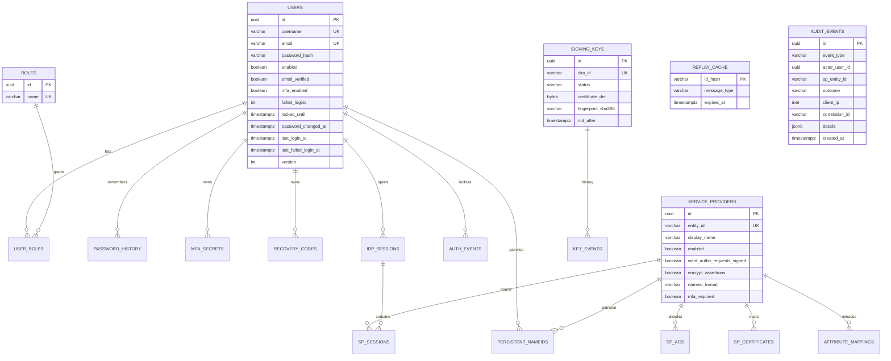

# Data model

PostgreSQL is the system of record. Flyway owns schema. Hibernate is mapped to Flyway tables, not the other way around.

## ER diagram

## Table list

| Table | Purpose |
| ----- | ------- |
| `users` | Local identities |
| `roles` | `USER`, `ADMIN`, `OPERATOR`, `AUDITOR` |
| `user_roles` | Many-to-many |
| `password_history` | Previous Argon2id hashes |
| `mfa_secrets` | Envelope-encrypted TOTP secret, algorithm, digits, period |
| `recovery_codes` | Salted hashes, `consumed_at` |
| `auth_source_throttle` | IP / subnet failure windows |
| `service_providers` | SP registry |
| `sp_acs` | ACS URL + binding allow-list |
| `sp_slo` | SLO URL + binding |
| `sp_certificates` | Signing and encryption certs, usage, fingerprints |
| `attribute_mappings` | Per-SP release rules |
| `persistent_nameids` | Pairwise opaque identifiers |
| `signing_keys` | Public cert + HSM CKA_ID + lifecycle status |
| `key_events` | Rotation audit (also in audit_events) |
| `idp_sessions` | SSO sessions |
| `sp_sessions` | Per-SP associations |
| `logout_correlation` | SLO in-flight |
| `replay_cache` | Message ID uniqueness |
| `authn_request_context` | Short-lived relay of validated request (or store in session) |
| `audit_events` | Security audit |
| `admin_bootstrap` | One-time setup token hash |

## Constraints and indexes

- `users(username)` unique lowercased
- `users(email)` unique lowercased
- `service_providers(entity_id)` unique
- `sp_acs(sp_id, binding, url)` unique
- `signing_keys` at most one row with `status='ACTIVE'` (partial unique index)
- `signing_keys` at most one `NEXT`
- `replay_cache(id_hash)` PK — insert conflict = replay
- `persistent_nameids(user_id, sp_id)` unique
- `idp_sessions(session_index)` unique
- Indexes: `audit_events(created_at)`, `audit_events(actor_user_id)`, `replay_cache(expires_at)`, `idp_sessions(user_id, last_seen_at)`

## Retention

| Data | Default TTL |
| ---- | ----------- |
| Replay cache | assertion TTL + request max age + 2×skew (~20–30 min) then purge |
| Authn request context | 15 minutes |
| Audit events | 365 days (configurable legal hold) |
| Logout correlation | 24 hours |
| Idle sessions | 30 minutes |
| Password history | 5 rows, not time-based |

## Transactions

Single transactions for:

- password verify + failure increment
- MFA confirm + secret persist + recovery hashes
- assertion issue + SP session insert + audit
- key activation swap
- logout + session delete + audit

Isolation: default READ COMMITTED. Replay uniqueness relies on the unique constraint, not on SERIALIZABLE.

## H2

No Flyway H2 dialect. Tests that need identity + SAML use Testcontainers PostgreSQL 16.
