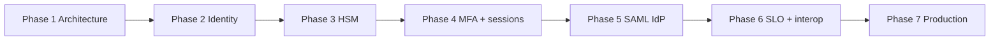

# Implementation roadmap

Gated. Do not start a phase until the previous phase’s acceptance criteria are met.

The original prompt’s five internal phases (architecture → technical design → implementation → testing → deployment) are mapped onto seven engineering increments so HSM, MFA, and SAML are not built in one lump.

## Phase 1 — Architecture and threat model

Delivered on `main`: specification review, blueprint, diagrams, threat model, data model, HSM design, ADRs, version pins, test matrix, SoftHSM runbook.

Acceptance:

- [x] Reviewer accepts ADRs 0001–0010
- [x] Reviewer accepts interoperability matrix
- [x] Deferred items (artifact, SOAP SLO, OIDC) remain deferred

## Phase 2 — Core identity platform

Delivered in Phase 2. Maven project, Flyway, users, roles, Argon2id, lockout, admin console, self-service profile/password, CSRF, security headers, JSON logs, fail-fast `prod` profile.

Runbook: [`runbooks/phase2-identity.md`](runbooks/phase2-identity.md)

Acceptance:

- [x] Admin can create, disable, unlock users (`AdminLifecycleIT`)
- [x] Enumeration-safe login tests pass (`LoginEnumerationIT`)
- [x] Lockout is stored in PostgreSQL and blocks later attempts (`LockoutIT`)
- [x] No H2 in the default test suite (`NoH2InClasspathTest`)

## Phase 3 — HSM integration

SunPKCS11 loader, SoftHSM runbook automated in CI where possible, `SigningService`, certificate table, rotation states, metadata certificate listing (even before full SAML), health sign-self-test.

**This pull request (with phases 4–7).** SunPKCS11 loader, software non-extractable token for tests, `SigningService`, certificate table, rotation states, metadata certificates, health sign-self-test.

Acceptance:

- [x] Key generated in token, not in a PEM file (`SigningKeyIT`)
- [x] Extractability test fails closed if key is extractable
- [x] Rotation publishes two certs; signing uses active only

## Phase 4 — MFA and session management

TOTP, QR, recovery codes, envelope encryption, MFA pending token, Spring Session JDBC, session revoke, step-up.

**This pull request.** TOTP, QR, recovery codes, envelope encryption, MFA pending token, Spring Session JDBC, session revoke, step-up.

Acceptance:

- [x] MFA-pending cannot reach `/account` or issue assertions (`SamlSsoIT`)
- [x] Recovery codes single-use (`MfaIT`)
- [x] Session revoke deletes the authoritative row (`SessionRevokeIT`)

## Phase 5 — SAML IdP

Metadata, AuthnRequest pipeline, assertion issuance, signing, optional encryption, SP registry UI, attribute mappers, SP- and IdP-initiated SSO. Runtime uses Santuario XML security (ADR 0011).

Acceptance:

- [x] Happy-path Redirect SSO issues a signed Response (`SamlSsoIT`)
- [x] Unregistered SP and bad ACS cannot obtain an assertion
- [x] CSRF is not required on SAML POST bindings
- Live Spring Security SP lab remains a follow-up row in interop notes

## Phase 6 — SLO and interoperability

SP- and IdP-initiated SLO, partial logout, correlation, lab against a second SP implementation.

**This pull request.** SP- and IdP-initiated SLO, partial logout, correlation, interop notes.

Acceptance:

- [x] SP-initiated LogoutRequest returns a signed LogoutResponse (`SloIT`)
- [x] Replay of LogoutRequest is rejected
- [x] Interop notes captured (NameID, encryption, clock skew)

## Phase 7 — Production readiness

Rate limiting hardening, backup/restore drill, monitoring dashboards, dependency scanning, load test of RSA-3072 signing, runbooks, TLS, secret manager, optional hardware HSM dry-run.

**This pull request.** Backup/restore drill, HSM readiness self-test, Prometheus, operations guide, production fail-fast for PKCS#11 and wrap key.

Acceptance:

- [x] Restore drill from backup unit succeeds (`BackupRestoreIT`)
- [x] Readiness includes HSM sign-self-test
- [x] Operations guide complete (`docs/runbooks/operations.md`)

---

## Phase 2 technical-design preview

When Phase 1 is approved, Phase 2 starts with a short technical design (package structure and Maven BOM are already drafted under `docs/reference/`) then code. That satisfies the original “do not generate the entire application in one response” rule.

## Priority if time is cut

1. Trust model (SP registry + ACS + signatures)
2. HSM sign
3. MFA gate on assertion issuance
4. PostgreSQL replay and sessions
5. SLO
6. Encryption fallback algorithms
7. Pretty admin UI
