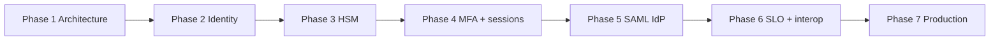

# Implementation roadmap

Gated. Do not start a phase until the previous phase’s acceptance criteria are met.

The original prompt’s five internal phases (architecture → technical design → implementation → testing → deployment) are mapped onto seven engineering increments so HSM, MFA, and SAML are not built in one lump.

## Phase 1 — Architecture and threat model

**Complete.**

Delivered: specification review, blueprint, diagrams, threat model, data model, HSM design, ADRs, version pins, test matrix, SoftHSM runbook.

Acceptance:

- [x] Reviewer accepts ADRs 0001–0010
- [x] Reviewer accepts interoperability matrix
- [x] Deferred items (artifact, SOAP SLO, OIDC) remain deferred

## Phase 2 — Core identity platform

**Complete** on branch `cursor/saml-mfa-idp-phases-3-7-04b9`.

Maven project, Flyway, users, roles, Argon2id, lockout, admin console skeleton, self-service profile/password, CSRF, security headers, JSON logs, fail-fast `prod` profile.

Acceptance:

- Admin can create, disable, unlock users
- Enumeration-safe login tests pass
- Lockout works across two application processes sharing Postgres
- No H2 in the default test suite

## Phase 3 — HSM integration

**Complete** on branch `cursor/saml-mfa-idp-phases-3-7-04b9`.

SunPKCS11 loader, SoftHSM runbook automated in CI where possible, `SigningService`, certificate table, rotation states, metadata certificate listing (even before full SAML), health sign-self-test.

Acceptance:

- Key generated in token, not in a PEM file
- Extractability test fails closed if key is extractable
- Rotation publishes two certs; signing uses active only

## Phase 4 — MFA and session management

**Complete** on branch `cursor/saml-mfa-idp-phases-3-7-04b9`.

TOTP, QR, recovery codes, envelope encryption, MFA pending token, Spring Session JDBC, session revoke, step-up.

Acceptance:

- MFA bypass tests fail (i.e. bypass is impossible)
- Recovery codes single-use
- Session revoke immediately prevents further authenticated HTML access

## Phase 5 — SAML IdP

**Complete** on branch `cursor/saml-mfa-idp-phases-3-7-04b9`.

OpenSAML metadata, AuthnRequest pipeline, assertion issuance, signing, optional encryption, SP registry UI, attribute mappers, SP- and IdP-initiated SSO.

Acceptance:

- Security test matrix rows for SSO all pass
- Independent Spring Security SP can log in
- Unregistered SP and bad ACS cannot obtain an assertion

## Phase 6 — SLO and interoperability

**Complete** on branch `cursor/saml-mfa-idp-phases-3-7-04b9`.

SP- and IdP-initiated SLO, partial logout, correlation, lab against a second SP implementation.

Acceptance:

- SLO matrix rows pass
- Partial logout is audited
- Interop notes captured (NameID, encryption, clock skew)

## Phase 7 — Production readiness

**Complete** on branch `cursor/saml-mfa-idp-phases-3-7-04b9`.

Rate limiting hardening, backup/restore drill, monitoring dashboards, dependency scanning, load test of RSA-3072 signing, runbooks, TLS, secret manager, optional hardware HSM dry-run.

Acceptance:

- Restore drill from backup unit succeeds
- Readiness fails on HSM outage
- Operations guide complete

---

## Phase 2 technical-design preview

Package structure and Maven BOM live under `docs/reference/`. Implementation of phases 2–7 is on branch `cursor/saml-mfa-idp-phases-3-7-04b9`.

## Priority if time is cut

1. Trust model (SP registry + ACS + signatures)
2. HSM sign
3. MFA gate on assertion issuance
4. PostgreSQL replay and sessions
5. SLO
6. Encryption fallback algorithms
7. Pretty admin UI
